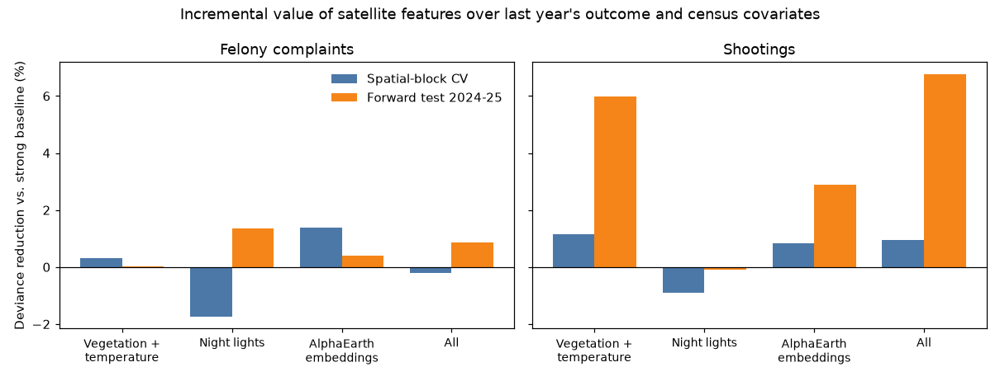

# nyc-from-orbit

Do satellite-derived features (heat, vegetation, night lights, learned image embeddings) add anything to next year's felony complaints and shooting counts for a New York City census tract, beyond last year's counts and census demographics? A tract-level, 2018-2025 test built on public data.

**Status: v0.1 in progress.** The data pipeline, incremental-value test and robustness checks run end to end. A radar probe shows Sentinel-1 backscatter tracks new-building filings, but radar features add about one percent or less to the prediction models. A static interactive map is built; the Power BI report is not finished.

## Headline result

- **Felony complaints:** once the baseline is specified properly (log-transformed lags, both outcomes' lags, log population and income), satellite features add no detectable predictive value. An earlier apparent gain of about 5% came from a weak baseline.
- **Shootings:** vegetation and temperature features may add a few percent in a forward test on 2024-2025, but not in spatial cross-validation, and the test covers only two years. This is a lead, not a finding.
- A placebo check (shuffling imagery across tracts) gives no gain, so the null result is not a pipeline bug.

Details, tables and limitations: [docs/RESULTS.md](docs/RESULTS.md).



## Interactive map

`python scripts/16_build_web_map.py` writes `docs/map/index.html`, a self-contained map (year slider; outcomes, vegetation, temperature, night lights, radar). Serve it with `python -m http.server` from `docs/map`, or host it on any static site. It loads Leaflet and OpenStreetMap tiles from the web.

## Data

NYC Open Data (complaints, shootings, tracts), American Community Survey, Sentinel-2, Landsat, VIIRS Black Marble, and AlphaEarth annual embeddings. All public; see [docs/DATA_SOURCES.md](docs/DATA_SOURCES.md). Two free credentials are needed: a Census API key (`CENSUS_API_KEY`) and a NASA Earthdata token (`EARTHDATA_TOKEN`).

## Run it

```bash
pip install -e ".[dev]"
```

The ordered script list is in [docs/RESULTS.md](docs/RESULTS.md#reproduce). Raw and derived data are not committed; scripts download them.

## Documents

- [docs/PLAN.md](docs/PLAN.md): original project plan
- [docs/PROBE.md](docs/PROBE.md): data availability probe
- [docs/RESULTS.md](docs/RESULTS.md): results and limitations
- [docs/MODEL_CARD.md](docs/MODEL_CARD.md): intended use and failure modes
- [docs/POWERBI.md](docs/POWERBI.md): Power BI data model and export

## Responsible use

This is an independent open-source project, not affiliated with or endorsed by the NYPD or any other agency. Reported crime reflects reporting and enforcement as well as offending. Results are descriptive and associational at annual, tract level; the project must not be used to target individuals or demographic groups.

## License

Code: MIT (see [LICENSE](LICENSE)). AlphaEarth embeddings are CC BY 4.0, produced by Google and Google DeepMind.
