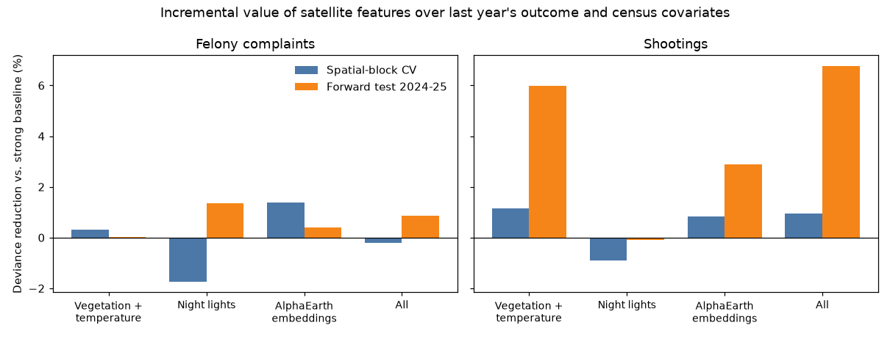

# Do satellite features add to tract-level crime prediction in New York City?

Two-page brief, v0.1. Independent open-source project, not affiliated with or endorsed by the NYPD or any other agency. Code and full results: this repository, especially [RESULTS.md](RESULTS.md).

## Question

Public satellite data now covers every New York City census tract every year: vegetation, surface temperature, night lights, radar, and learned image embeddings. Analysts often assume such features carry information about where crime happens. This project asks a narrow, testable version of that claim:

> Do satellite-derived features from year t-1 improve out-of-sample prediction of year-t felony complaints and shooting incidents for a census tract, beyond last year's counts and census demographics?

The aim is an honest measurement of added value, not a crime-forecasting product.

## Data and design

- **Unit:** 2020 census tracts with at least 100 residents (about 2,190), target years 2019-2025, about 15,000 tract-years.
- **Outcomes:** felony complaints and shooting incidents from NYC Open Data, counted per tract-year from geocoded points.
- **Baseline covariates:** last year's counts of both outcomes, log population, and 2023 American Community Survey income, age, poverty, renter share and bachelor's share. The census values are held constant across years, a known simplification.
- **Satellite features (previous year):** summer Sentinel-2 vegetation index, summer Landsat surface temperature, VIIRS annual night lights, eight principal components of Google's AlphaEarth annual embeddings, and Sentinel-1 radar backscatter and its one-year change.
- **Model:** Poisson regression with a population offset, plus year and county effects. Adding features is judged only on held-out data.
- **Validation:** (1) spatial-block cross-validation, holding out whole clusters of neighbouring tracts; (2) a forward test, training on targets through 2023 and testing on 2024-2025.
- **Metric:** percent reduction in out-of-sample Poisson deviance relative to the baseline.

## Findings

**1. The baseline matters more than the imagery.** With a simple baseline, satellite features looked useful for felony complaints (about 5% in spatial cross-validation). Once the baseline used log-transformed lags, both outcomes' lags, and log population and income, that gain disappeared: all imagery sets fell within about two points of zero. The apparent signal was a weak baseline, not new information.

**2. Felony complaints: no detectable value from imagery.** Negative binomial regression and dropping the top 1% of tracts also leave gains within about two points of zero.

**3. Shootings: a possible small signal, not a conclusion.** Under the strong baseline, vegetation and temperature features cut forward-test deviance by about 6% (about 10% with negative binomial), and all optical, night-light and embedding features together by 7-11%. In spatial cross-validation the same features give only about 1%. The forward test spans two years, and shootings fell sharply in 2025, so a distribution shift may be doing part of the work.

**4. Radar sees construction but does not help prediction.** Sentinel-1 backscatter change is positively associated with new-building filings from the Department of Buildings (Spearman +0.30 for 2018-2025 change against 2018-2023 filings, 2,325 tracts), so the sensor and pipeline work. Adding radar level and change to the models gives about 1% or less for either outcome, close to the placebo.

**5. The pipeline is not producing spurious gains.** Shuffling imagery across tracts within each year gives gains between -0.9% and +0.3%.

## What this means

- For felony complaints, a tract's own recent history and demographics already capture what these features offer. Satellite data is not a shortcut to better tract-level forecasts of reported crime.
- For shootings, vegetation and heat may carry some information, but the evidence is two forward-test years and one validation scheme out of two. It is a lead that needs more years and a time-varying demographic baseline before anyone relies on it.
- A negative or near-null result with a clear baseline is itself useful: it saves analysts from adding expensive features that do not move accuracy.

## Limits

- Reported crime reflects reporting and enforcement behaviour as well as offending. Complaint counts are not victimization.
- Everything is annual and tract-level. Night-light pixels (about 460 x 350 m) are larger than many tracts, and crime concentrates at finer places and times.
- Census covariates are static (2023). Demographic change over 2018-2025 is not modelled, which may inflate or hide imagery effects.
- The 2018 Landsat summer composite has only three usable scenes. AlphaEarth embeddings are reduced to eight components and their inputs are not fully documented.
- Results are associations and descriptive. They say nothing about causes.

## Responsible use

The project is not suitable for targeting individuals or demographic groups, or for resource allocation without independent review of reporting bias. The [model card](MODEL_CARD.md) lists intended uses and failure modes.

## Reproduce and explore

All inputs are public; two free credentials are needed (a Census API key and a NASA Earthdata token). Scripts `01` to `16` in `scripts/` run the pipeline in order, and the commands are listed in [RESULTS.md](RESULTS.md#reproduce). `scripts/16_build_web_map.py` builds an interactive map with a year slider for outcomes and each satellite feature. Next steps: more forward-test years as 2026 data arrives, time-varying census covariates, and a spatial error analysis.
