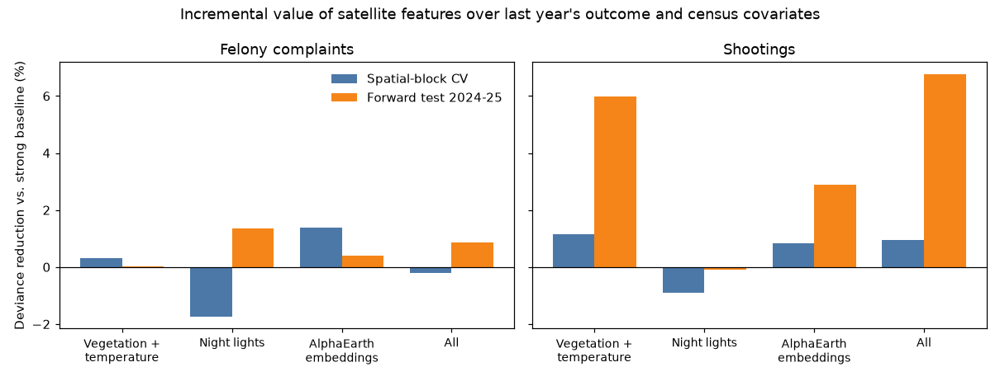
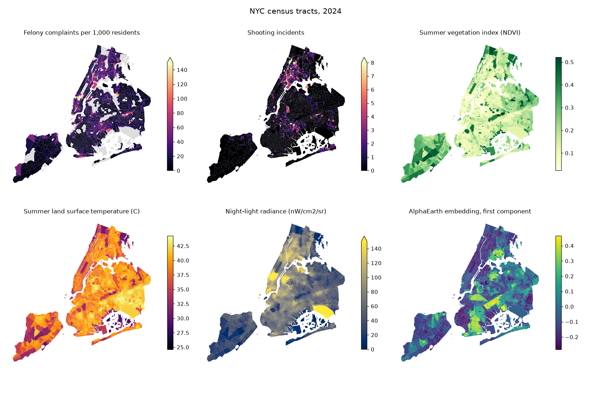

# Results (v0.1)

Question: do satellite-derived features, measured in year t-1, improve out-of-sample prediction of year-t outcomes at the census-tract level, beyond last year's outcome and census covariates?

Short answer: **for felony complaints, no detectable improvement once the baseline is specified properly. For shootings, a possible small improvement that rests on two forward-test years and is not stable across validation schemes.** All results are associations in annual tract-level data and say nothing about causes.

## Data and design

- Unit: 2020 census tract (2,190 tracts with at least 100 residents), 2018-2025 outcomes, 15,330 tract-years usable after lags.
- Outcomes: felony complaints and shooting incidents (NYC Open Data), geocoded points counted per tract-year.
- Covariates: 2023 ACS 5-year (income, age, poverty, renter share, bachelor's share, population). **Held constant across years**, a known simplification.
- Satellite features (previous year): summer Sentinel-2 vegetation index, summer Landsat surface temperature, VIIRS annual night lights, and 8 principal components of AlphaEarth annual embeddings, all averaged per tract.
- Models: Poisson regression with a log-population offset, plus year and county effects. Feature sets are added to a baseline and compared on held-out data.
- Validation: (1) spatial-block cross-validation, where whole spatial clusters of tracts are held out; (2) a forward test, trained on targets up to 2023 and tested on 2024-2025.
- Metric: out-of-sample Poisson deviance; "gain" is the percent reduction versus the baseline.

## Finding 1: the baseline matters more than the imagery

With a simple baseline (last year's count entered linearly plus ACS covariates), satellite features appeared to help by about 5% in spatial cross-validation. Robustness checks showed this was largely a specification effect:

| Baseline | Vegetation + temp (CV / forward) | Night lights | Embeddings | All |
|---|---|---|---|---|
| Simple baseline | +5.3 / -15.1 | +2.5 / +8.4 | +5.1 / +3.4 | +6.5 / +3.1 |
| Strong baseline (log lag, both outcomes' lags, log population and income) | +0.3 / 0.0 | -1.7 / +1.4 | +1.4 / +0.4 | -0.2 / +0.9 |

(Felony complaints; percent deviance reduction; spatial-block CV / forward test.) Under the strong baseline, negative binomial regression and dropping the top 1% of tracts give gains within about 2 points of zero.



## Finding 2: shootings are the one place a signal may exist

Under the strong baseline, vegetation and temperature features reduce forward-test deviance by about 6% (about 10% with negative binomial, 6% with the top 1% of tracts dropped), and all features together by 7-11%. In spatial cross-validation the same features give only about 1%. The forward test covers two years, so this is a lead worth following, not a conclusion.

## Radar probe: does Sentinel-1 see construction?

A time-boxed check of whether C-band radar backscatter (Sentinel-1 RTC, ascending orbit 33, June-August median, VV polarisation, 20 m) tracks building activity, measured against DOB new-building and full-demolition job filings (legacy BIS and DOB NOW, 2018 onward). This tests the sensor, not crime: radar features are not yet in the prediction models.

| View | Test | Estimate | n |
|---|---|---|---|
| Long difference | Spearman, 2025 minus 2018 VV vs new-building filings 2018-2023 | +0.30 | 2,325 tracts |
| Long difference | Spearman, same change vs demolition filings | +0.24 | 2,325 |
| Long difference | OLS, dB per new-building filing (controls: 2018 VV, log population) | +0.005 (p < 0.001) | 2,325 |
| Long difference | OLS, dB per demolition filing | 0.000 (p = 0.99) | 2,325 |
| Long difference | Top 5% of tracts by filings minus tracts with none | +0.50 dB | 117 vs none |
| Panel | OLS, year-over-year VV change vs filings in the two prior years (year effects, tract-clustered SE) | +0.002 dB per filing (p < 0.001) | 13,950 tract-years |

Reading: tracts with more new-building filings show larger backscatter increases, a modest but clear association. Demolition filings show a rank association but no effect once new buildings and controls are included. Filings are applications, not completed buildings, and one filing can be a large tower or a small house, so counts are a noisy yardstick; effect sizes are small in absolute terms. Backscatter level and change were then added to the prediction models (below).

### Radar features in the prediction models

Sentinel-1 summer VV and VH backscatter (previous year), and the one-year VV change, were added to the strong baseline and tested the same way (Poisson; spatial-block CV / forward test; percent deviance reduction).

| Outcome | Radar level | Level + change (target years 2020 on) | All optical, light, embed | All with radar |
|---|---|---|---|---|
| Felony complaints | +0.8 / +0.3 | +0.6 / +0.3 | -0.2 / +0.9 | -0.6 / +0.4 |
| Shootings | +0.6 / +0.7 | +0.5 / +1.0 | +0.9 / +6.8 | +1.7 / +6.2 |

Negative binomial raises the radar-level gains to about +1.0 to +1.6 and a different fold seed lowers them to about +0.3 to +0.7. Shuffling the radar columns across tracts gives -0.3 to +0.1, so the small positive values are above the placebo but of the order of one percent. Reading: radar sees construction (previous section) but does not add usable predictive value for either outcome. For shootings the forward-test gain still comes from the optical and embedding features, and adding radar to them does not raise it (6.8 to 6.2).

## Checks that passed

- **Placebo:** shuffling imagery features across tracts within each year gave gains between -0.9% and +0.3%, as it should.
- Under the simple baseline, the vegetation/temperature and embedding gains stayed at about 3-8% across fold seeds, 20 or 80 spatial clusters, a ridge penalty and dropping the pandemic years, while the night-light gain swung between -9% and +10% with the fold assignment. Those fold, cluster, ridge and pandemic-year variants were not repeated under the strong baseline; only the Poisson, negative binomial and top-1%-dropped variants were.

## Limitations

- ACS covariates are static (2023), so demographic change over the period is not modelled.
- Reported crime reflects reporting and enforcement as well as offending. Complaint counts are not a measure of victimization.
- Annual, tract-level features are coarse relative to the places and times where crime occurs. Night-light pixels (about 460 x 350 m) are larger than many tracts.
- The Landsat 2018 summer composite uses only 3 usable scenes; the temperature feature is noisier that year.
- The forward test has two years. Shootings fell sharply in 2025, a distribution shift that may affect it.
- AlphaEarth embeddings are learned from imagery and other sources whose details are not fully documented here; they were reduced to 8 components, which may discard information.
- Not yet done in v0.1: a spatial error analysis, and time-varying ACS covariates.

## Reproduce

```bash
pip install -e ".[dev]"
python scripts/01_fetch_tabular.py     # needs CENSUS_API_KEY
python scripts/02_features_s2.py 2018 2019 2020 2021 2022 2023 2024 2025
python scripts/03_features_landsat.py 2018 2019 2020 2021 2022 2023 2024 2025
python scripts/04_aef_index.py
python scripts/05_features_aef.py 2017 2018 2019 2020 2021 2022 2023 2024 2025
python scripts/06_features_viirs.py 2018 2019 2020 2021 2022 2023 2024 2025   # needs EARTHDATA_TOKEN
python scripts/07_build_panel.py
python scripts/08_incremental_value.py felony_complaints
python scripts/09_robustness.py felony_complaints
python scripts/10_make_figures.py
python scripts/12_fetch_dob.py
python scripts/13_features_s1.py 2018 2019 2020 2021 2022 2023 2024 2025
python scripts/14_radar_probe.py
python scripts/15_radar_models.py felony_complaints
python scripts/15_radar_models.py shootings
python scripts/16_build_web_map.py
```

## Maps


